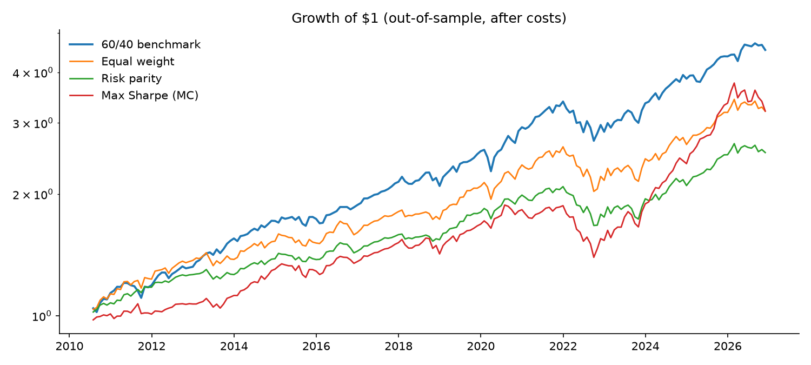
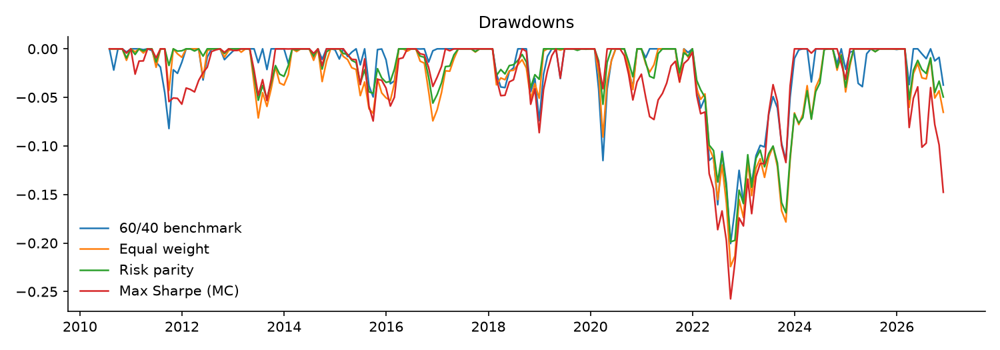
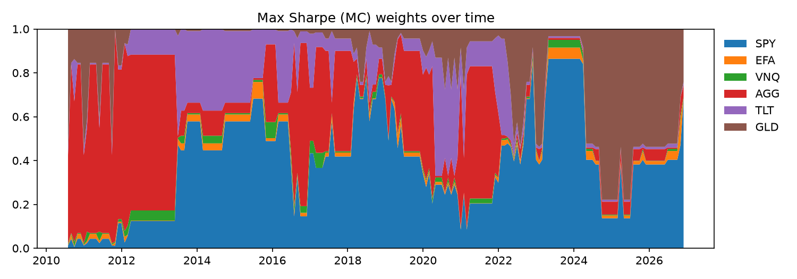

# Multi-Asset Backtester and Performance Attribution Engine

A walk-forward backtest of three portfolio construction methods across six ETFs, compared against
a 60/40 benchmark, with risk metrics and Brinson-Fachler performance attribution.

## Setup
- **Universe:** SPY (US equity), EFA (international equity), VNQ (REITs), AGG (US bonds),
  TLT (long Treasuries), GLD (gold). Risk-free rate: BIL (T-bills).
- **Benchmark:** 60% SPY / 40% AGG, rebalanced monthly.
- **Strategies** (long-only, rebalanced monthly):
  1. **Equal weight:** 1/6 in each ETF.
  2. **Risk parity:** weights proportional to 1 / volatility.
  3. **Max Sharpe (Monte Carlo):** 10,000 random portfolios; pick the highest Sharpe.
- **Out-of-sample by design:** every rebalance uses only the previous 36 months of data.
- **Transaction costs:** 5 bps on every dollar traded.

## Results
Out-of-sample period: Jul 2010 to Nov 2026, after 5 bps trading costs.

|                   | 60/40 benchmark | Equal weight | Risk parity | Max Sharpe (MC) |
|:------------------|:----------------|:-------------|:------------|:----------------|
| Ann. return       | 9.7%  | 7.4%  | 5.8%  | 7.4%  |
| Ann. volatility   | 9.2%  | 9.2%  | 7.3%  | 9.6%  |
| Sharpe            | 0.90  | 0.67  | 0.63  | 0.64  |
| Sortino           | 1.45  | 1.03  | 0.95  | 0.99  |
| Max drawdown      | -20.1% | -22.4% | -19.9% | -25.8% |
| Beta vs 60/40     | 1.00  | 0.84  | 0.62  | 0.74  |
| Tracking error    | 0.0%  | 5.2%  | 5.7%  | 7.3%  |
| Information ratio | n/a   | -0.41 | -0.65 | -0.29 |




## Performance attribution (Brinson-Fachler, vs 60/40)
Average basis points per year, by asset class (Equity, Fixed Income, Alternatives):
- **Allocation:** did the strategy overweight asset classes that beat the benchmark?
- **Selection:** within each class, did its ETFs beat the benchmark's ETF?
- **Interaction:** the combined effect.

|                      | Equal weight | Risk parity | Max Sharpe (MC) |
|:---------------------|-------------:|------------:|----------------:|
| Allocation           | -37  | -262 | -149 |
| Selection            | -211 | -210 | -105 |
| Interaction          | 35   | 99   | 58   |
| Costs (vs benchmark) | -1   | -1   | -13  |
| **Total excess return** | **-213** | **-374** | **-209** |



## Key findings
- **60/40 was hard to beat.** It had the highest return and Sharpe ratio (0.90) of every strategy
  tested, because US equities had an exceptional run from 2010 to 2026.
- **Diversification cost 2-4% a year.** Attribution shows where: risk parity's -374 bps/yr came
  mostly from *allocation* (-262 bps, underweighting equities) and *selection* (-210 bps, holding
  international stocks, REITs and long Treasuries instead of only SPY and AGG).
- **Optimizing on past returns backfired.** The Monte Carlo max-Sharpe portfolio had the deepest
  drawdown (-25.8%), a classic sign of estimation error: it chases whatever did well in the
  trailing 36 months.
- **Risk parity delivered on risk, not return.** Lowest volatility (7.3%) and smallest drawdown
  (-19.9%), but the weakest return.
- **Trading costs were negligible** (at most 13 bps/yr), so the results come from the weights, not from turnover.

## Files
- `data.py`: downloads prices (yfinance) and builds monthly returns
- `strategies.py`: equal weight, risk parity, Monte Carlo max Sharpe, 60/40 benchmark
- `backtest.py`: walk-forward engine with monthly rebalancing and costs
- `metrics.py`: return, volatility, Sharpe, Sortino, max drawdown, beta, tracking error, information ratio
- `attribution.py`: Brinson-Fachler attribution by asset class
- `run_backtest.py`: runs everything and saves tables and charts to `results/`

## Run it
```
pip install -r requirements.txt
python run_backtest.py
```
